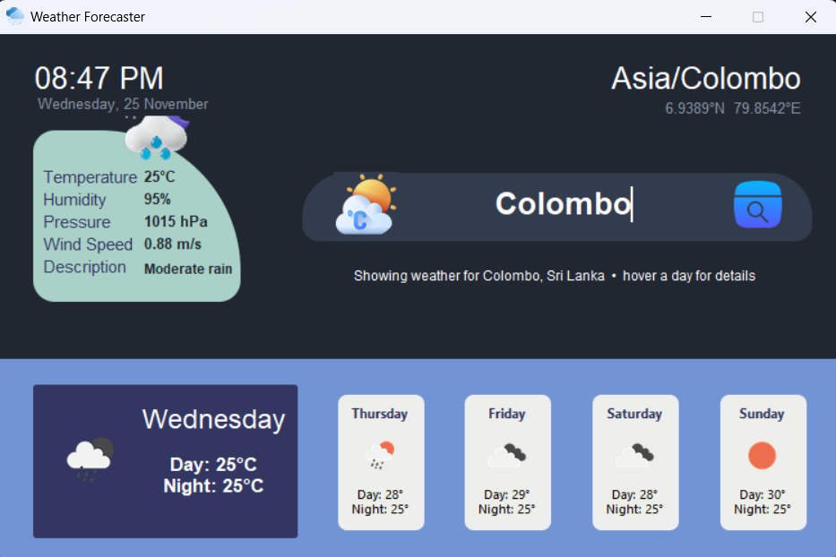
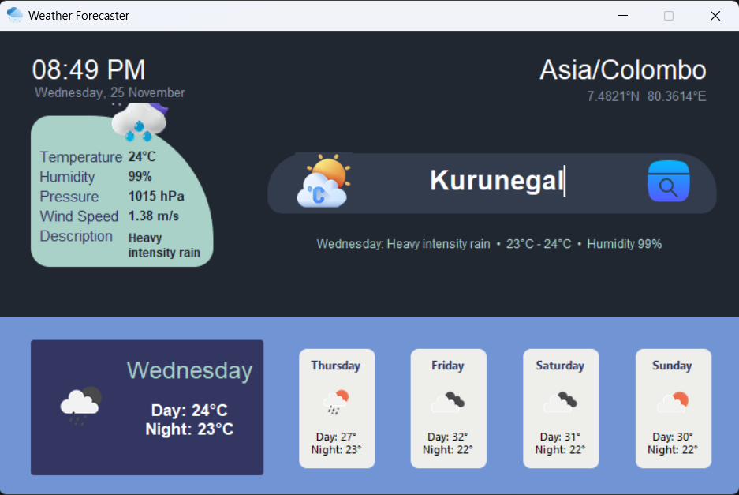
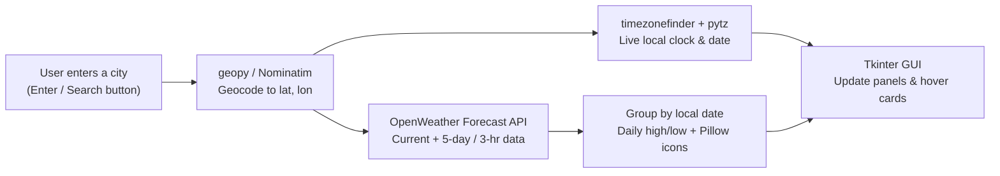

<div align="center">


# 🌦️ Advance Weather Forecaster

**A desktop weather forecasting application built with Python & Tkinter that shows real-time weather, live local time, and an interactive 5-day weather forecast for any city in the world.**


</div>

---

## 📖 Overview

Advance Weather Forecaster is an interactive GUI desktop application. You type the name of a city, town, country, or landmark, and it shows:

- 🌡️ **Current temperature** (°C), 💧 **humidity** (%), 🔽 **atmospheric pressure** (hPa), 💨 **wind speed** (m/s), and ☁️ **weather description**
- 📅 **5-day weather forecast** with dynamic weather icons and daily **Day (High)** and **Night (Low)** temperatures
- 🕒 **Live ticking local clock & date** at the searched location, together with its **IANA time zone** and **GPS coordinates** (`°N/°S`, `°E/°W`)
- ✨ **Interactive forecast cards** — hover over any of the 5 day cards to inspect that day's condition summary, temperature range, and humidity in the status bar

The app chains three services together. It **geocodes** the place name into coordinates, **finds the time zone** for those coordinates, then **fetches live 5-day / 3-hour forecast data** from the OpenWeather API.

<p align="center">
  
</p>

---

## 📸 App Screenshots

<table>
  <tr>
    <td align="center" width="33%">
      
      <br><b>Country search: Sri Lanka</b>
    </td>
    <td align="center" width="33%">
      
      <br><b>City search: Colombo</b>
    </td>
    <td align="center" width="33%">
      
      <br><b>Town search & card hover: Kurunegala</b>
    </td>
  </tr>
</table>

Each search updates the **live local time & date**, **time zone**, **coordinates**, **current weather metrics**, and **5-day forecast cards with dynamic weather icons**.

---

## ✨ Features

| Feature | Description |
|---|---|
| 🔍 **Search any place** | Accepts cities, towns, countries, or landmarks, resolved through OpenStreetMap Nominatim |
| 📅 **5-day forecast & icons** | Aggregates 3-hourly forecast slots by local date to compute daily high/low temperatures and displays matching `@2x` weather condition icons |
| 🖱️ **Interactive UI** | Press **Enter** or click the search button (with hover highlight) to search; hover over any forecast card to view detailed daily stats in the status bar |
| 🌍 **Time-zone aware live clock** | Shows a live ticking clock and date in the searched location's time zone, plus formatted `N/S` and `E/W` coordinates |
| 🛡️ **Error handling** | Shows clear pop-ups and status bar alerts for empty input, unknown locations, network failures, timeouts, and invalid API keys instead of crashing |
| 🔐 **Secure configuration** | The API key is loaded from a `.env` file and is never hard-coded or committed |

---

## 🛠️ Tech Stack & Skills Demonstrated

| Area | Technologies / Concepts |
|---|---|
| **Language** | Python 3 |
| **GUI development** | Tkinter: windows, `Frame`, `Entry`, `Button`, `Label`, `PhotoImage`, custom layouts with `place()` / `pack()`, keyboard & mouse hover event bindings, `after()` timer loop |
| **Image processing** | `Pillow` (`PIL.Image`, `ImageTk`, `ImageEnhance`) for high-quality (`LANCZOS`) weather icon resizing and dynamic button hover brightening |
| **REST API integration** | `requests`: query parameters, timeouts, HTTP status checks, JSON parsing of OpenWeather `2.5/forecast` data |
| **Geocoding** | `geopy` (Nominatim / OpenStreetMap) to convert place names to latitude and longitude |
| **Time zones** | `timezonefinder` + `pytz` to convert coordinates into an IANA time zone and compute local dates and times |
| **Configuration & security** | `python-dotenv` and environment variables to keep secrets out of source control |
| **Robustness** | Defensive programming: input validation and handling for network, service, and API errors |
| **Tooling** | Git version control, virtual environments, `requirements.txt` dependency management |

---

## ⚙️ How It Works



1. **Input:** the user types a location and presses **Enter** or clicks the search button.
2. **Geocoding:** `Nominatim.geocode()` converts the text into latitude and longitude coordinates.
3. **Time zone:** `TimezoneFinder.timezone_at()` returns the IANA time zone (e.g. `Asia/Colombo`), and `pytz` drives the live local clock and date.
4. **Weather & Forecast:** a `GET` request goes to `api.openweathermap.org/data/2.5/forecast` with the coordinates and `units=metric`.
5. **Aggregation & Display:** the first entry populates the current weather panel, while all 3-hour entries are grouped by the city's local date to calculate each day's high (`Day`) and low (`Night`) temperatures, load the matching icon from `icon/`, and bind hover details to each card.

---

## 🚀 Getting Started

### Prerequisites

- **Python 3.10+** with Tkinter (included with the standard Python installer on Windows and macOS; on Linux, install `python3-tk`)
- A free **OpenWeather API key**. Sign up at [openweathermap.org/api](https://openweathermap.org/api). New keys can take a little while to activate.

### Installation

```bash
# 1. Clone the repository
git clone https://github.com/Nilupul925/<your-repo-name>.git
cd "<your-repo-name>"

# 2. Create and activate a virtual environment
python -m venv .venv
# Windows
.venv\Scripts\activate
# macOS / Linux
source .venv/bin/activate

# 3. Install dependencies
pip install -r requirements.txt
```

### Configuration

Copy the example environment file and add your API key:

```bash
# Windows
copy .env.example .env
# macOS / Linux
cp .env.example .env
```

Then edit `.env`:

```env
API_key=your_openweathermap_api_key_here
```

> ⚠️ `.env` is listed in `.gitignore`. Never commit your real API key.

### Run the App

```bash
python application.py
```

---

## 🧭 Usage

1. Launch the app with `python application.py`.
2. Type a location into the search bar, for example `Colombo`, `Kurunegala`, `London`, or `Tokyo`.
3. Press **Enter** or click the 🔍 **search** button.
4. The app updates the live local clock, date, time zone, coordinates, current weather panel, and 5-day forecast cards.
5. **Hover your mouse over any forecast card** at the bottom to highlight the day and view its detailed forecast (`Condition • Min°C - Max°C • Humidity`) in the status bar under the search box.

| Situation | What the app does |
|---|---|
| Empty search box | Asks you to enter a location |
| Location not found | Shows `"Location '…' not found"` in a dialog and the status bar |
| No internet / service timeout | Shows a connection error message |
| Missing or invalid API key | Shows the error returned by the OpenWeather API |

---

## 📂 Project Structure

```text
P-2_Advance Weather App/
├── Images/                          # GUI background panels, search bar, and README screenshots
│   ├── Layer 7.png
│   ├── logo.png
│   ├── Rounded Rectangle 1.png
│   ├── Rounded Rectangle 2.png
│   ├── Rounded Rectangle 2 copy.png
│   ├── Rounded Rectangle 3.png
│   ├── search_icon.png
│   └── Screenshot-1..3.png
├── icon/                            # OpenWeather condition icons (01d@2x.png .. 50n@2x.png)
├── .env.example                     # Template for environment variables
├── .gitignore                       # Keeps secrets and local files out of Git
├── requirements.txt                 # Python dependencies
├── application.py                   # Application entry point (GUI + forecast logic)
└── README.md
```

---

## 🔮 Future Improvements

- [ ] °C / °F temperature unit toggle
- [ ] Hourly forecast breakdown when clicking a day card
- [ ] Remember recent searches / favourite cities dropdown
- [ ] Auto-detect current location on startup
- [ ] Package as a standalone executable with PyInstaller

---

## 🙏 Acknowledgements

- [OpenWeather](https://openweathermap.org/) for the 5-day / 3-hour weather forecast API and weather condition icons
- [OpenStreetMap Nominatim](https://nominatim.openstreetmap.org/) for geocoding
- [geopy](https://github.com/geopy/geopy), [timezonefinder](https://github.com/jannikmi/timezonefinder), [pytz](https://pythonhosted.org/pytz/), and [Pillow](https://python-pillow.org/)

---
